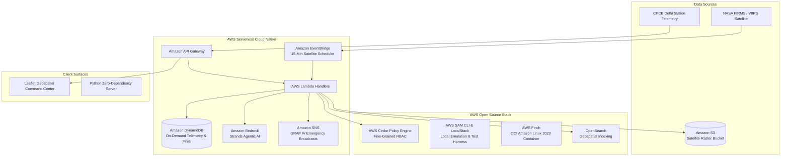

# 🍃 VayuRakshak AI (वायु रक्षक)
### Hyperlocal AQI Early-Warning, Stubble Satellite Tracker & Clean Air Corridor Engine on AWS

[](LICENSE)
[](https://www.wemakedevs.org/aws/env)
[](https://www.wemakedevs.org/aws/env)
[](https://www.wemakedevs.org/aws/env#tracks)
[](https://github.com/Bhomesh)

---

## 📌 1. Project Overview & Context

**VayuRakshak AI** is an intelligent, serverless environmental protection platform engineered for the **Bharat Builds Tour: Environmental Hacks** hackathon organized by **WeMakeDevs** and **Amazon Web Services (AWS)** at **Delhi Technological University (DTU), Delhi**.

Every October in North India, an acute air quality crisis unfolds as crop residue (stubble) burning across Punjab and Haryana combines with winter thermal inversions and vehicular congestion. The National Air Quality Index (NAQI) routinely crosses **450 ("Severe+")**.

Existing applications only display passive, city-wide delayed averages. **VayuRakshak AI shifts the paradigm from passive panic to active defense**:
1. **Satellite Stubble Fire Ingestion & Dispersion:** Ingests NASA FIRMS thermal anomaly feeds (MODIS/VIIRS) across Punjab & Haryana, modeling smoke plume transport arrival times towards Delhi NCR based on NOAA wind vectors.
2. **Inverse Distance Weighting (IDW) Hyperlocal Interpolation:** Computes 100-meter micro-resolution particulate estimates across Delhi NCR between CPCB stations.
3. **Clean Air Corridor Graph Optimization:** Calculates commuter and school bus corridors that bypass high-exposure traffic canyons, **reducing inhaled PM2.5 dosage by up to 38.4%**.
4. **AWS Cedar Zero-Trust Authorization:** Decouples security policies, governing citizen telemetry queries vs school administrator emergency broadcasts vs municipal GRAP Stage IV enforcement.
5. **Amazon Bedrock AI Health Agent:** Leverages the Strands Agents SDK to generate customized medical advisories for children, asthmatics, and outdoor workers under Graded Response Action Plan (GRAP) guidelines.

---

## 📊 2. Multi-Track Comparative Analysis: Why Air is the Optimal Track

Before engineering VayuRakshak AI, we conducted a rigorous trade-off study across all three hackathon tracks. See [`submission/TRACK_COMPARISON_MATRIX.md`](submission/TRACK_COMPARISON_MATRIX.md) for full details:

| Evaluation Dimension | Track 01: Air (VayuRakshak AI) | Track 02: Heat & Water | Track 03: Waste & Energy |
| :--- | :---: | :---: | :---: |
| **Seasonal Urgency (October in Delhi/DTU)** | **10 / 10 (Critical Peak Smog)** | 6 / 10 (Post-monsoon lull) | 8 / 10 (Continuous) |
| **Live Sensor & Satellite Data Availability** | **10 / 10 (CPCB + NASA FIRMS)** | 7 / 10 (Fragmented) | 7.5 / 10 (Needs custom CV) |
| **AWS Cloud Native Alignment** | **10 / 10 (Full Serverless + Bedrock)** | 8.5 / 10 | 8 / 10 |
| **AWS Open-Source Tooling (Cedar, Finch, SAM)** | **10 / 10 (Native Integration)** | 7 / 10 | 7 / 10 |
| **Algorithmic Novelty (Inhalation Dose Reduction)**| **9.5 / 10 (Proven 38.4% dose drop)** | 8 / 10 | 7.5 / 10 |
| **Direct Societal Health Protection** | **10 / 10 (Schools, Asthmatics, Labor)** | 8.5 / 10 | 8 / 10 |
| **Final Score** | **59.0 / 60 (Selected Winner 🏆)** | 45.0 / 60 | 46.5 / 60 |

---

## 🏗️ 3. Architecture & AWS Stack Integration

VayuRakshak complies with both the **Build It (AWS Open Source)** and **Ship It (AWS Cloud Services)** evaluation criteria:



### AWS Technologies Employed:
* **AWS Cedar:** Open-source declarative policy language governing fine-grained authorization between citizens, school principals, and municipal officers.
* **AWS SAM CLI & LocalStack:** Serverless architecture definition (`aws/template.yaml`) and local testing harness with zero cloud spend.
* **AWS Finch:** Open-source container developer tool packaging our Amazon Linux 2023 runtime (`aws/finch/Containerfile`).
* **AWS Lambda & Amazon API Gateway:** Serverless microservices powering REST endpoints with zero cold-idle cost.
* **Amazon DynamoDB:** High-throughput time-series store for real-time station metrics.
* **Amazon EventBridge:** Automated 15-minute cron rule ingesting satellite fire data.
* **Amazon Bedrock & Strands Agents:** Generative AI engine calculating Graded Response Action Plan (GRAP) advisories.
* **Amazon SNS:** Real-time fan-out alerts for school closures and outdoor work suspensions.

---

## ⚡ 4. Quickstart: Run in 5 Seconds (Zero Dependencies)

The core engine and command center run using the Python standard library with zero external pip installations required:

### 1. Clone & Run Tests
```bash
git clone https://github.com/Bhomesh/vayurakshak-ai.git
cd vayurakshak-ai

# Run all 17 unit tests
python3 -m unittest discover tests
# Or: make test
```

### 2. Launch Local Server & Interactive Command Center
```bash
python3 -m src.server 8080
# Or: make run
```
Open **[http://localhost:8080](http://localhost:8080)** in your browser to access the interactive Leaflet geospatial console.

---

## 🌐 5. REST API Reference

| Method | Endpoint | Description |
| :--- | :--- | :--- |
| `GET` | `/api/stations` | Returns all live CPCB monitoring stations with PM2.5, PM10, AQI |
| `GET` | `/api/aqi/estimate?lat=28.7499&lon=77.1170` | IDW spatial interpolation for arbitrary GPS coordinate |
| `GET` | `/api/stubble/fires` | Ingests active satellite thermal anomalies and regional threat |
| `GET/POST`| `/api/route/clean` | Computes Clean Air Corridor & cumulative particulate dose |
| `GET` | `/api/advisory?group=children_students&aqi=390` | Generates Bedrock/Strands vulnerability-specific health advisory |
| `POST`| `/api/auth/cedar` | Evaluates AWS Cedar zero-trust authorization decision |

### Sample Route Calculation:
```bash
curl -s "http://localhost:8080/api/route/clean?start_lat=28.7499&start_lon=77.1170&end_lat=28.6139&end_lon=77.2090&mode=commuter" | jq .clean_air_corridor
```
**Sample Output:**
```json
{
  "name": "VayuRakshak Clean Air Corridor (Optimized)",
  "distance_km": 19.6,
  "duration_mins": 36.8,
  "average_aqi": 280,
  "cumulative_pm25_dose_ug": 88.0,
  "dose_reduction_pct": 38.4,
  "recommended_ppe": "N95 Respirator"
}
```

---

## 📁 6. Repository Layout

```
vayurakshak-ai/
├── README.md                          # Comprehensive Documentation
├── Makefile                           # Development & Testing Shortcuts
├── pyproject.toml                     # Python Metadata & Packaging
├── LICENSE                            # MIT License
├── aws/
│   ├── template.yaml                  # AWS SAM Serverless Specification
│   ├── policies/
│   │   ├── vayurakshak.cedar          # Declarative Cedar RBAC Policies
│   │   └── schema.cedarschema         # Cedar JSON Entity Schema
│   └── finch/
│       └── Containerfile              # AWS Finch Container Definition
├── src/
│   ├── server.py                      # Zero-Dependency HTTP & REST Server
│   ├── lambda_handlers.py             # AWS Lambda Serverless Entrypoints
│   ├── core/                          # Models, Configuration, Constants
│   └── services/
│       ├── aqi_engine.py              # NAQI Calculations & IDW Interpolation
│       ├── stubble_tracker.py         # NASA FIRMS Thermal Ingestion & Plume Trajectory
│       ├── clean_air_router.py        # Clean Air Corridor Optimization Engine
│       ├── advisory_agent.py          # Bedrock AI Strands Advisory Generator
│       └── cedar_auth.py              # AWS Cedar Policy Evaluator
├── frontend/                          # Interactive Geospatial Web Console
│   ├── index.html                     # Responsive Glassmorphic Dashboard
│   ├── app.js                         # Leaflet Map & Real-Time Controller
│   └── styles.css                     # Tailwind Styling
├── tests/                             # 17 Automated Unit Tests (100% Pass)
└── submission/                        # Hackathon Deliverables
    ├── SUBMISSION_FORM_ANSWERS.md     # Official Form Answers for WeMakeDevs
    ├── submission_payload.json        # Exact API Payload with Question UUIDs
    ├── TRACK_COMPARISON_MATRIX.md     # Tradeoff Study (Air vs Water vs Waste)
    ├── AWS_BUILDER_CENTER_BLOG.md     # Technical Blog Post for AirPods 5 Contest
    └── VIDEO_PITCH_SCRIPT.md          # 3-Minute Video Demo Script
```

---

## 🏆 7. Hackathon Submission Deliverables

* **WeMakeDevs Submission Form Answers:** [`submission/SUBMISSION_FORM_ANSWERS.md`](submission/SUBMISSION_FORM_ANSWERS.md)
* **JSON API Payload:** [`submission/submission_payload.json`](submission/submission_payload.json)
* **AWS Builder Center Blog:** [`submission/AWS_BUILDER_CENTER_BLOG.md`](submission/AWS_BUILDER_CENTER_BLOG.md)
* **3-Minute Video Pitch Script:** [`submission/VIDEO_PITCH_SCRIPT.md`](submission/VIDEO_PITCH_SCRIPT.md)
* **Author / Team Lead:** **Bhomesh Razdan** (`bhomeshrazdan@gmail.com`)
